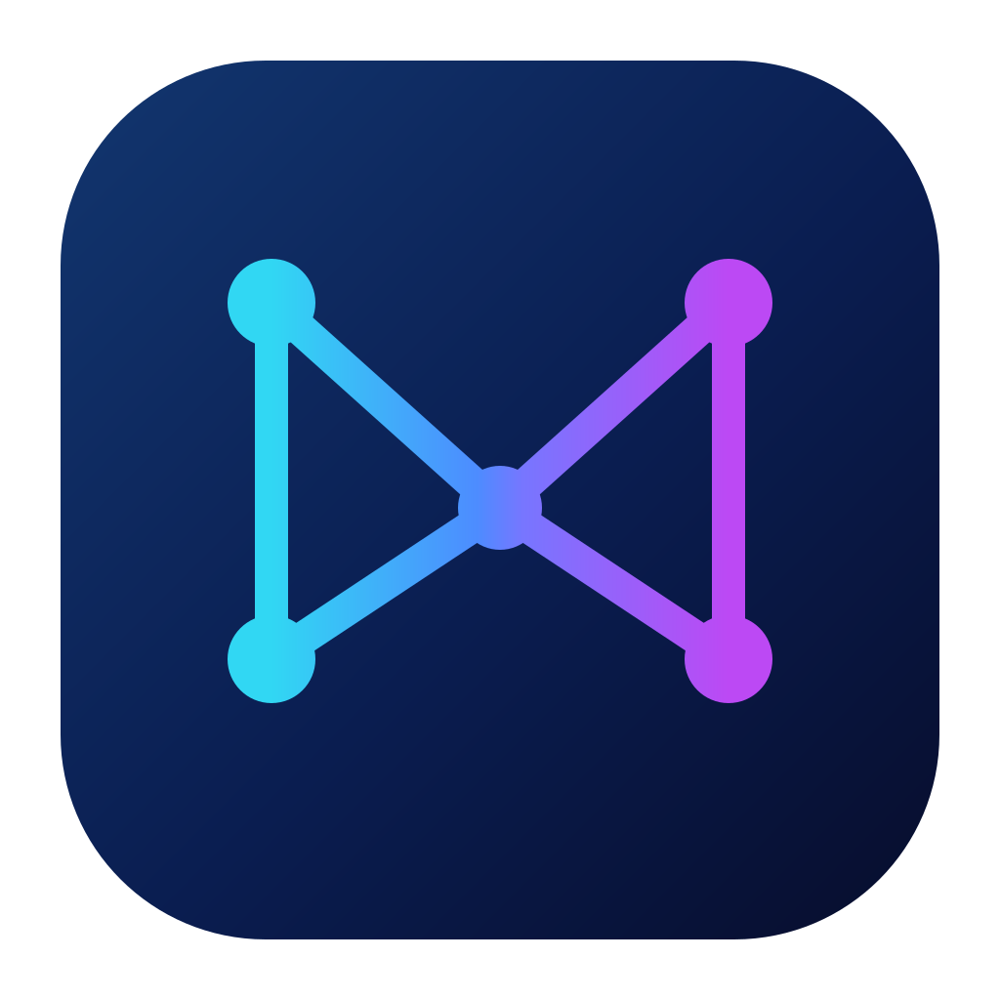

# Meshboard

A collaborative whiteboard for sketching ideas together. Share a link or QR code
and draw with others on web, mobile, and desktop.

Use Meshboard at [meshboard.site](https://meshboard.site). The provided native
binaries connect to the same server.

Draw, add notes and images, connect ideas, and undo your own changes. Shared boards
use end-to-end encryption. No accounts, analytics, or cloud storage.

Boards stay in memory while participants are connected. Export and local recovery
are still being built.

[Development setup](docs/development.md) · [Self-hosting](docs/deployment.md)

Licensed under [MPL-2.0](LICENSE). Third-party components retain their own licenses.
